# ServiceNow AI Portal Architecture Diagrams

This document describes how the current application works end to end:
- what is fetched from ServiceNow via MCP
- what is fetched directly from ServiceNow
- how data is ingested into Neo4j
- how the frontend, backend, GraphRAG, and ticketing flows connect
- which exact modules are hit at runtime

---

## 0. Correct MCP-to-ServiceNow-to-Neo4j Diagram

Use this one when you need the accurate story of how catalog data moves.

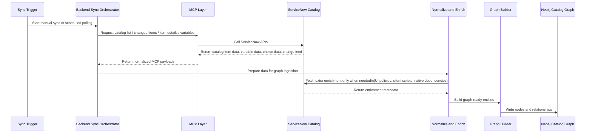

### What this means
1. The backend does not call ServiceNow directly for the main catalog fetch when MCP is being used.
2. The backend calls MCP.
3. MCP calls ServiceNow.
4. ServiceNow returns data to MCP.
5. MCP returns the payload back to the backend.
6. The backend then enriches and converts that payload into graph structures.
7. Neo4j stores the final nodes and relationships.

### Important clarification
- Main catalog retrieval path: `Backend -> MCP -> ServiceNow -> MCP -> Backend`
- Extra enrichment path: `Backend -> ServiceNow -> Backend`
- Final graph write path: `Backend -> Neo4j`

---

## 0A. Presentation-Friendly Flow

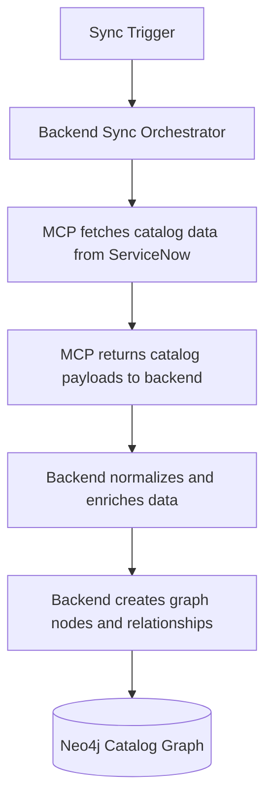

### What is fetched from ServiceNow through MCP
- Catalog items
- Catalog item details
- Variables / form fields
- Choice lists
- Catalog change feed

### What may still be fetched directly from ServiceNow during catalog ingestion
- UI policies
- Native field dependency metadata
- Client scripts

### What is written into Neo4j
- `CatalogItem`
- `FilterSchema`
- `CatalogVariable`
- `CatalogChoice`
- Relationships between items, schemas, variables, and choices

---

## 1. Full End-to-End Architecture

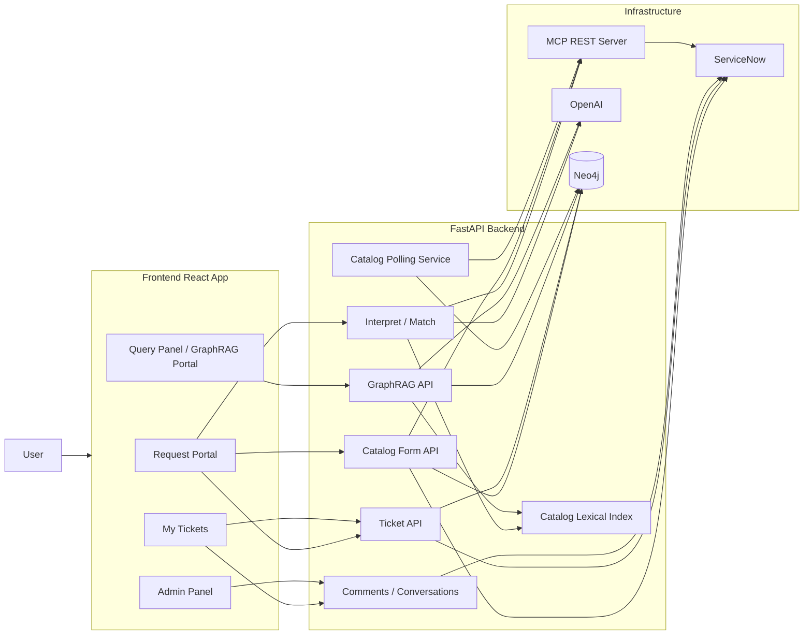

### Summary
- The frontend talks only to the FastAPI backend.
- MCP is mainly used for catalog retrieval and catalog change detection.
- Ticket creation, ticket fetch, comments, and user lookup still go directly to ServiceNow.
- Neo4j stores catalog, schema, and ticket graph data.
- GraphRAG queries Neo4j and uses OpenAI for planning, compilation, and answer synthesis.

---

## 1A. Module-Level Runtime Hit Map

This diagram shows the exact file/module path that gets hit for the main user journeys.

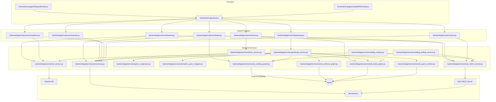

### How to read it
- `GraphRAGPortal.jsx -> client.js -> routers/graphrag.py -> services/graphrag_service.py` is the query-panel path.
- `RequestPortal.jsx -> client.js -> routers/catalog.py` is the catalog/form path.
- `RequestPortal.jsx -> client.js -> routers/tickets.py -> ticket_service.py -> servicenow.py` is the ticket creation path.

---

## 2. MCP to ServiceNow Catalog Fetch Path

These are the main MCP tools currently used by the backend:
- `list_catalog_items`
- `get_catalog_item`
- `list_catalog_item_variables`
- `list_catalog_changes`

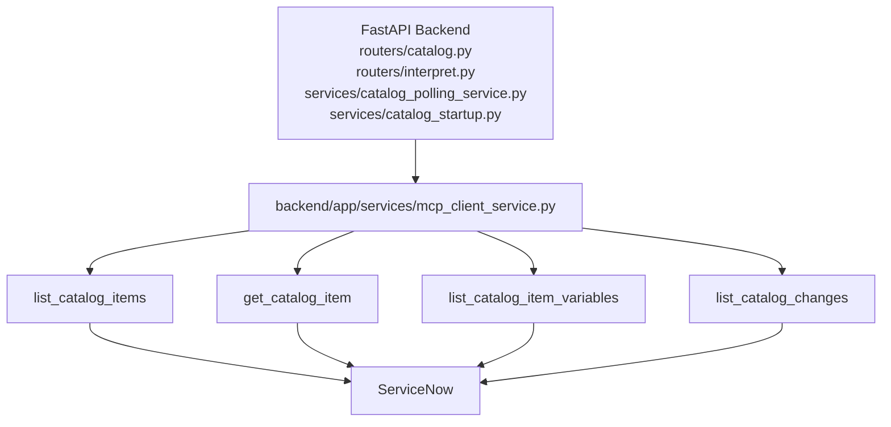

### What comes through MCP
- Catalog item lists
- Catalog item metadata
- Catalog variables and choices
- Catalog change detection for polling

### Exact modules that call MCP
- [backend/app/routers/catalog.py](</c:/Projects/SubhajitServiceNow/backend/app/routers/catalog.py>)
- [backend/app/routers/interpret.py](</c:/Projects/SubhajitServiceNow/backend/app/routers/interpret.py>)
- [backend/app/services/catalog_polling_service.py](</c:/Projects/SubhajitServiceNow/backend/app/services/catalog_polling_service.py>)
- [backend/app/services/catalog_startup.py](</c:/Projects/SubhajitServiceNow/backend/app/services/catalog_startup.py>)
- [backend/app/services/ai_service.py](</c:/Projects/SubhajitServiceNow/backend/app/services/ai_service.py>) indirectly through interpret/search flows

### What does not currently go through MCP
- Ticket creation
- Ticket fetch
- Comments / work notes
- User lookup
- Some catalog enrichment calls like UI policies and client scripts

---

## 3. Catalog Ingestion into Neo4j

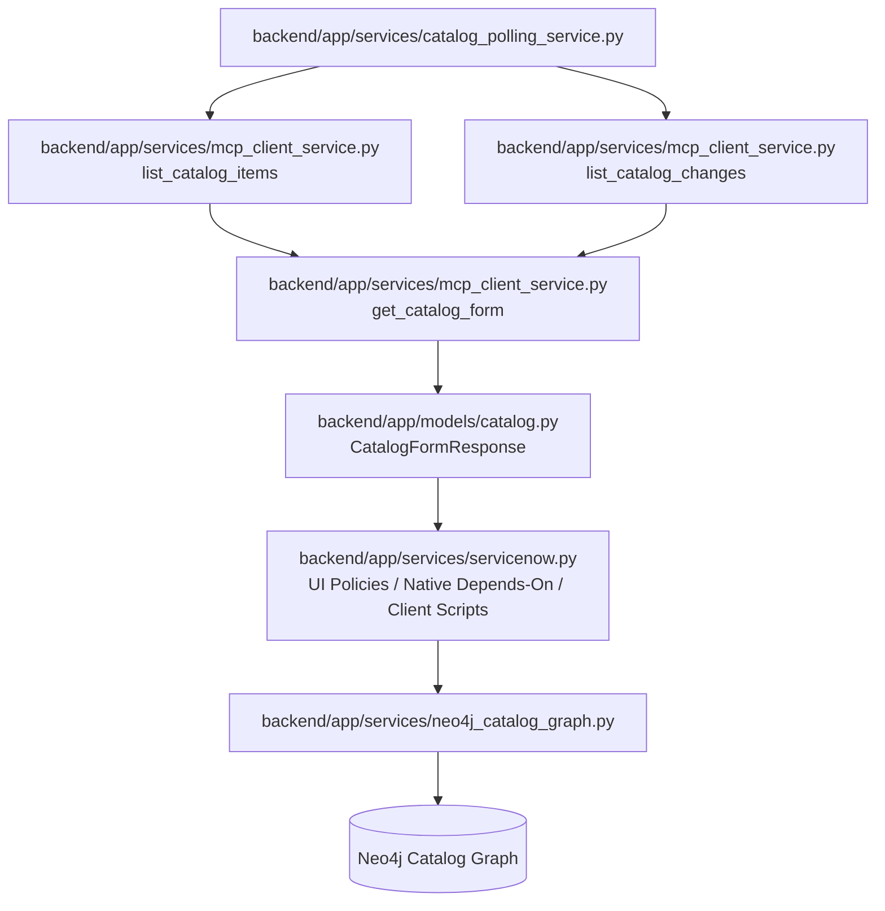

### Neo4j catalog graph content
- `CatalogItem`
- `FilterSchema`
- `CatalogVariable`
- `CatalogChoice`

### Neo4j catalog relationships
- `(:CatalogItem)-[:USES_SCHEMA]->(:FilterSchema)`
- `(:FilterSchema)-[:HAS_FIELD]->(:CatalogVariable)`
- `(:CatalogVariable)-[:HAS_CHOICE]->(:CatalogChoice)`

### Catalog sync entry points
- `POST /api/catalog/{sys_id}/graph/sync`
- `POST /api/catalog/graph/sync-all`
- background polling via `catalog_polling_service`

### Exact runtime hit
1. `routers/catalog.py` or `catalog_polling_service.py`
2. `mcp_client_service.get_catalog_form()`
3. `servicenow.py` enrichment helpers
4. `neo4j_catalog_graph_service.sync_catalog_form()`
5. Neo4j write

---

## 4. Ticket Ingestion into Neo4j

Tickets do not currently use MCP. They go directly through the ServiceNow service layer.

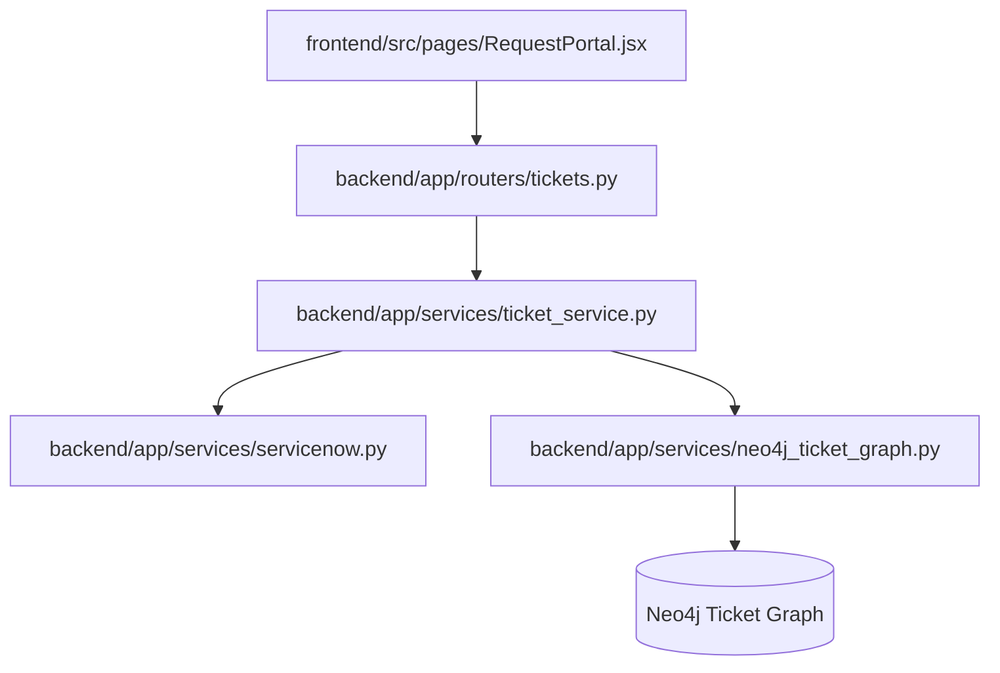

### Ticket graph nodes
- `Ticket`
- `ServiceRequest`
- `ChangeRequest`
- `RequestItem`
- `User`

### Ticket graph relationships
- `(:User)-[:REQUESTED]->(:Ticket)`
- `(:User)-[:ASSIGNED_TO]->(:Ticket)`
- `(:Ticket)-[:HAS_ITEM]->(:RequestItem)`
- `(:RequestItem)-[:FULFILLS_CATALOG_ITEM]->(:CatalogItem)`

### Ticket sync behavior
- Automatic sync after new SR / CH creation
- Manual sync via:
  - `POST /api/tickets/graph/sync-all`
  - `POST /api/tickets/{ticket_type}/{sys_id}/graph/sync`
- Opportunistic sync on ticket fetch

### Exact runtime hit for SR creation
1. `frontend/src/pages/RequestPortal.jsx`
2. `frontend/src/api/client.js -> createSR()`
3. `backend/app/routers/tickets.py -> create_sr()`
4. `backend/app/services/ticket_service.py -> create_sr()`
5. `backend/app/services/servicenow.py -> order_catalog_item()`
6. `backend/app/services/servicenow.py -> get_service_request()`
7. `backend/app/services/servicenow.py -> get_ritm_details_by_request_sysid()` or request-item fetch helper
8. `backend/app/services/servicenow.py -> patch_service_request() / patch_request_item()`
9. `backend/app/services/neo4j_ticket_graph.py -> sync_service_request()`
10. Neo4j write

---

## 5. Catalog Form Runtime Flow

This is the live request-form path when the frontend asks for a catalog form.

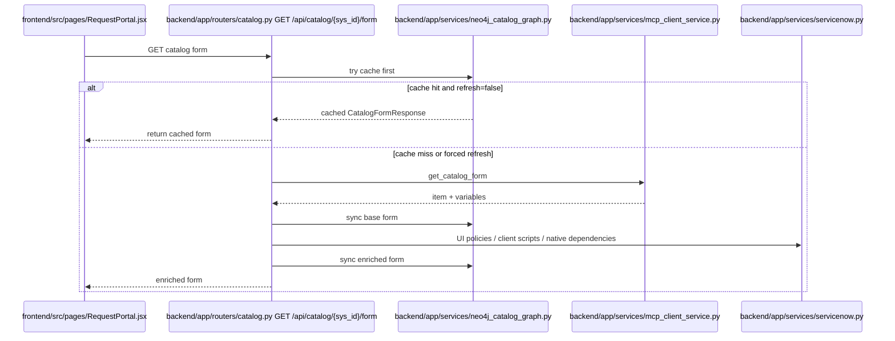

---

## 6. Query Panel / GraphRAG Flow

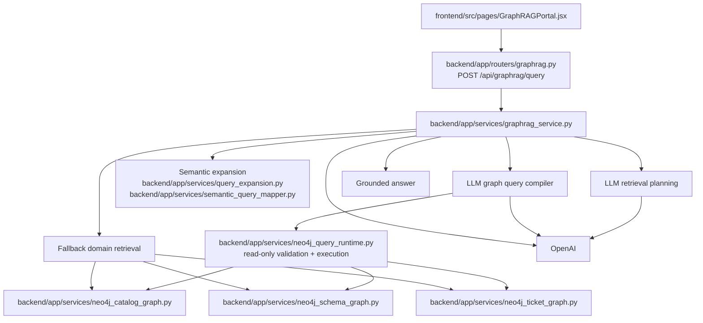

### Query panel request payload
The frontend sends:
- `query`
- `user_sys_id`
- `user_email`
- `session_id`

### Current GraphRAG execution order
1. Build a structured retrieval plan
2. Expand terms semantically
3. Compile a read-only Cypher query against the known graph schema
4. Validate the compiled query using the safe Neo4j runtime
5. Execute the query against Neo4j
6. Generate a grounded answer from returned rows
7. Fall back to the older domain retrieval path if compiled query execution fails or returns no useful rows

### Exact module hit for query panel
1. `frontend/src/pages/GraphRAGPortal.jsx`
2. `frontend/src/api/client.js -> queryGraphRAG()`
3. `backend/app/routers/graphrag.py -> graph_rag_query()`
4. `backend/app/services/graphrag_service.py -> query()`
5. `backend/app/services/ai_service.py -> get_async_client()` for OpenAI calls
6. `backend/app/services/query_expansion.py`
7. `backend/app/services/semantic_query_mapper.py`
8. `backend/app/services/neo4j_query_runtime.py` for validated compiled Cypher execution
9. Fallback to:
   - `backend/app/services/neo4j_catalog_graph.py`
   - `backend/app/services/neo4j_schema_graph.py`
   - `backend/app/services/neo4j_ticket_graph.py`
10. Answer returned to frontend

---

## 7. Lexical Index and Query Expansion

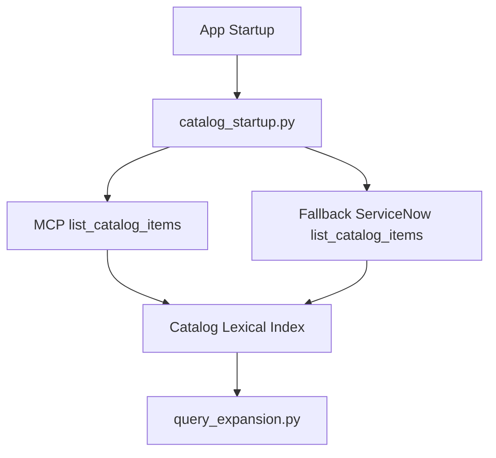

### Why this exists
- Keeps query expansion grounded in real catalog vocabulary
- Supports lexical retrieval and semantic hinting
- Feeds both interpret/search flows and GraphRAG assistance

---

## 8. Frontend to Backend API Map

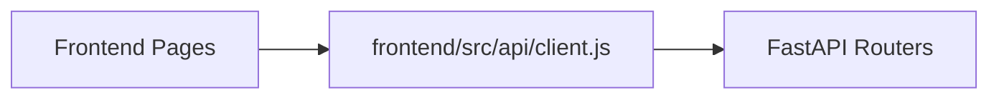

### Main frontend pages
- `RequestPortal`
- `GraphRAGPortal`
- `My Tickets`
- `Admin Panel`

### Main backend routers
- `catalog.py`
- `tickets.py`
- `comments.py`
- `conversations.py`
- `graphrag.py`
- `users.py`
- `interpret.py`

---

## 9. MCP vs Direct ServiceNow Responsibilities

| Area | Through MCP | Direct ServiceNow |
|---|---|---|
| Catalog search | Yes | Fallback sometimes |
| Catalog item fetch | Yes | Sometimes fallback |
| Catalog variables | Yes | Also used for enrichment |
| Catalog change polling | Yes | No |
| Catalog UI policies | No | Yes |
| Catalog client scripts | No | Yes |
| User lookup | No | Yes |
| SR creation | No | Yes |
| CH creation | No | Yes |
| Ticket fetch/list | No | Yes |
| Comments/work notes | No | Yes |
| Ticket graph sync source | No | Yes |

---

## 9A. Direct Module Ownership by Capability

| Capability | Entry Module | Main Service Module | External Hit |
|---|---|---|---|
| Interpret request | `routers/interpret.py` | `services/ai_service.py` | OpenAI, MCP, sometimes ServiceNow |
| Catalog search | `routers/catalog.py` | `services/mcp_client_service.py` | MCP -> ServiceNow |
| Catalog form fetch | `routers/catalog.py` | `services/mcp_client_service.py`, `services/servicenow.py`, `services/neo4j_catalog_graph.py` | MCP + direct ServiceNow + Neo4j |
| Catalog graph polling | startup / polling | `services/catalog_polling_service.py` | MCP -> ServiceNow -> Neo4j |
| Ticket creation | `routers/tickets.py` | `services/ticket_service.py` | direct ServiceNow -> Neo4j |
| Ticket listing/fetch | `routers/tickets.py` | `services/ticket_service.py` | direct ServiceNow |
| Comment sync | `routers/comments.py` | `services/servicenow.py` | direct ServiceNow |
| Conversation relay | `routers/conversations.py` | `services/ai_service.py`, `services/servicenow.py` | OpenAI + direct ServiceNow |
| Query panel | `routers/graphrag.py` | `services/graphrag_service.py` | OpenAI + Neo4j |

---

## 10. Practical Notes

### Cleanest pipeline today
- Catalog ingestion and catalog retrieval are the cleanest MCP-backed flows.

### Direct-ServiceNow-heavy pipeline today
- Ticketing, comments, conversations, and user lookup still go through the direct ServiceNow service layer.

### Query panel capabilities
- Query panel now uses Neo4j as the main retrieval source.
- It supports catalog, schema, and ticket graph querying.
- Complex multi-hop questions depend on:
  - graph completeness
  - correct ticket-to-request-item-to-catalog links
  - enough underlying graph evidence in Neo4j

---

## 11. Key Files

### Frontend
- `frontend/src/pages/GraphRAGPortal.jsx`
- `frontend/src/api/client.js`

### Backend routers
- `backend/app/routers/catalog.py`
- `backend/app/routers/tickets.py`
- `backend/app/routers/graphrag.py`
- `backend/app/routers/comments.py`
- `backend/app/routers/conversations.py`
- `backend/app/routers/users.py`

### Backend services
- `backend/app/services/mcp_client_service.py`
- `backend/app/services/catalog_polling_service.py`
- `backend/app/services/catalog_startup.py`
- `backend/app/services/ticket_service.py`
- `backend/app/services/graphrag_service.py`
- `backend/app/services/neo4j_catalog_graph.py`
- `backend/app/services/neo4j_schema_graph.py`
- `backend/app/services/neo4j_ticket_graph.py`
- `backend/app/services/neo4j_query_runtime.py`
