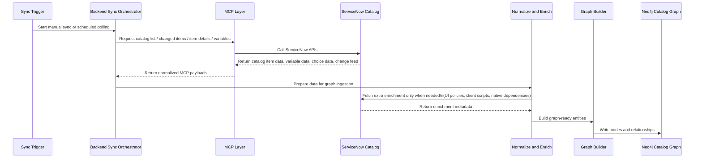
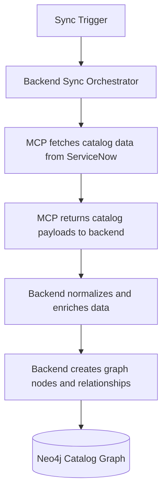

# Catalog MCP to Neo4j Flow

This file contains the standalone diagram for how catalog data is fetched through MCP and ingested into Neo4j.

---

## Correct MCP to ServiceNow to Neo4j Flow

### Meaning
1. The backend starts the sync.
2. The backend asks MCP for catalog data.
3. MCP calls ServiceNow.
4. ServiceNow returns data back to MCP.
5. MCP returns the payload back to the backend.
6. The backend normalizes and enriches the data.
7. The backend builds graph entities and writes them into Neo4j.

### Important Clarification
- Main catalog retrieval path:
  - `Backend -> MCP -> ServiceNow -> MCP -> Backend`
- Extra enrichment path:
  - `Backend -> ServiceNow -> Backend`
- Final graph write path:
  - `Backend -> Neo4j`

---

## Presentation-Friendly Version

### What comes through MCP
- Catalog items
- Catalog item details
- Variables / form fields
- Choice lists
- Catalog change feed

### What may still be fetched directly from ServiceNow
- UI policies
- Native dependency metadata
- Client scripts

### What is written to Neo4j
- `CatalogItem`
- `FilterSchema`
- `CatalogVariable`
- `CatalogChoice`
- Relationships between them
