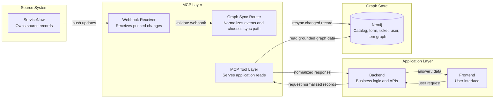
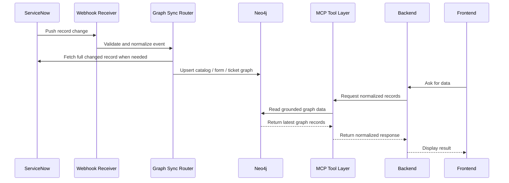
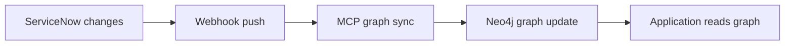

# Webhook-To-Neo4j MCP Architecture

This document shows the high-level architecture for a webhook-only MCP update model. ServiceNow pushes updates into the MCP layer, MCP syncs those changes into Neo4j, and the application reads grounded graph data through the backend/MCP layer.

---

## 1. Architecture And Responsibility Boundaries

---

## 2. End-To-End Update And Read Flow

---

## 3. Webhook-Only Principle

Updates are pushed by ServiceNow. The application does not run scheduled polling to discover updates once webhooks are configured.
